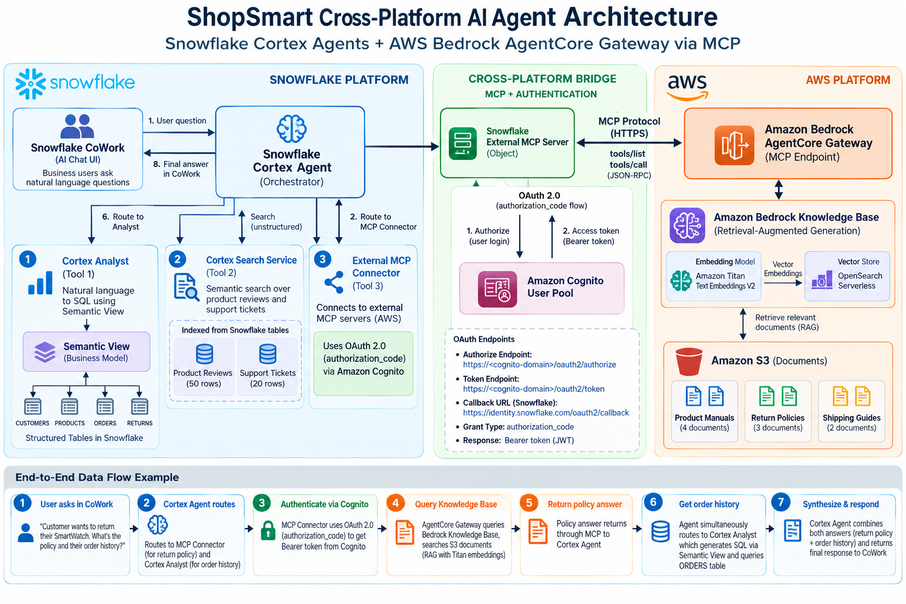

# ShopSmart Cross-Platform AI Demo

## Snowflake Cortex Agents + AWS Bedrock AgentCore Gateway

A retail/e-commerce demo where a **single Snowflake Cortex Agent** answers questions across data that lives in both **Snowflake** and **AWS S3**, queryable from **Snowflake CoWork**.

## Architecture



### What data lives where

| Location | Data | Tool |
|----------|------|------|
| Snowflake tables | Customers, Products, Orders, Returns | Cortex Analyst (via Semantic View) |
| Snowflake stage | Product reviews, Support tickets | Cortex Search |
| AWS S3 | Product manuals, Return policies, Shipping guides, Warranty info | Bedrock KB (via AgentCore Gateway MCP) |

### Prerequisites

- Snowflake account with Cortex Agents and CoWork enabled
- AWS account with Bedrock and AgentCore access
- Both accounts with public internet access (no VPN/private network required for demo)

### Step-by-step guides

1. **[AWS Setup Guide](docs/aws-setup-guide.md)** -- S3, Bedrock KB, AgentCore Gateway
2. **[Snowflake Setup Guide](docs/snowflake-setup-guide.md)** -- Tables, Cortex Search, Semantic View, MCP integration, Agent
3. **[Demo Script](demo/demo_script.md)** -- Questions to ask in CoWork

### File structure

```
aws/s3-data/               <- Upload these files to your S3 bucket
  product-manuals/          <- 4 product manuals (markdown)
  return-policies/          <- 3 policy documents
  shipping-guides/          <- 2 shipping guides
docs/                       <- Step-by-step guides
snowflake/                  <- SQL scripts to run in Snowflake
demo/                       <- Demo walkthrough
```
